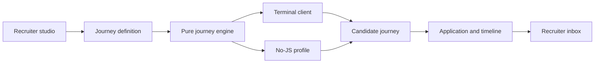

# knockport — engineering case study

**An exploratory hiring journey rather than another resume-scoring system.**

[Back to README](../README.md) · [Watch the 81-second demo](https://github.com/guillaume-flambard/knockport/releases/download/v0.1.0/demo-final.mp4) · [Release v0.1.0](https://github.com/guillaume-flambard/knockport/releases/tag/v0.1.0)

## The problem and the proposed solution

A conventional job advert can be a flat list of requirements. knockport experiments with a different interaction: an employer authors a navigable workspace, a candidate uses simple terminal commands to discover the product and role, and the employer receives a timeline of the journey with the application.

The project deliberately **does not score or rank candidates automatically**. This is an implementation decision, not a proven improvement in hiring. No external adoption, hiring conversion or time-saving metrics are claimed.

## What to examine in the code

| Concern | Implementation | Why it matters |
| --- | --- | --- |
| Candidate journey and routing | [Pure engine](../packages/core) | A deterministic model can be tested without a browser or database |
| Terminal interaction | [Browser client](../packages/terminal) | The UI stays small and delegates the domain rules to the server |
| Recruitment studio and server | [Web application](../apps/web) | Content editing, preview, application intake and sessions use the same model |
| Accessibility fallback | `/j/<slug>/profile` in the web application | People can read the role and contact the employer without JavaScript |
| Contract and browser tests | [Playwright configuration](../playwright.config.ts) | Browser-driven coverage complements unit tests and server-side validation |
| Capture/replay | [Demo pipeline](../scripts/demo) | The public walkthrough is generated from a repeatable scripted journey |



## Decisions and tradeoffs

**Pure TypeScript core.** The same domain behavior is used by the browser terminal and other adapters. No UI framework owns the journey rules.

**Server-side terminal sessions.** The browser paints text; it does not decide which content a candidate may see. The server accepts commands and returns output.

**Accessibility is a separate path.** A terminal metaphor must not be required to discover the entire role. The server-rendered profile offers a first-class fallback, not just an error page.

**Evidence rather than screening scores.** The inbox displays a chronological history instead of estimating merit. Even a timeline contains personal information and requires thoughtful retention and disclosure before real hiring use.

**The demo is a demo.** The walkthrough uses scripted inputs. Its existence does not prove a production deployment, employer adoption, candidate consent or recruiting outcomes.

## How to reproduce the engineering checks

Prerequisites: **Node.js 24**, **pnpm 10.14**. Run from the repository root.

```sh
pnpm install --frozen-lockfile
pnpm seed
pnpm dev
```

Open the local journey at `http://localhost:3010/j/memo-labs`.

In another terminal:

```sh
pnpm audit:full
pnpm exec playwright install --with-deps chromium
pnpm test:e2e
```

To rebuild the product walkthrough, see [the demo README](../scripts/demo/README.md). The video linked above is the existing `v0.1.0` asset; it is not presented as a new clean-user verification on the date of this document.

## Validation still required before real recruiting use

- [ ] Independent employer and candidate walkthrough with **new accounts**, consent and accessible keyboard/screen-reader journeys.
- [ ] Reconfirm applicant-data handling, retention and deletion, including how timelines are disclosed.
- [ ] Re-run every E2E workflow on the exact release candidate and review the screenshots for readability.
- [ ] Independent security review of the studio, WebSocket session boundaries and application intake.
- [ ] Measure real-world comprehension and friction before making any hiring-effectiveness claims.

**Honest scope:** a real full-stack implementation with a recorded scripted demo and automated checks. Not a validated commercial recruitment service.
